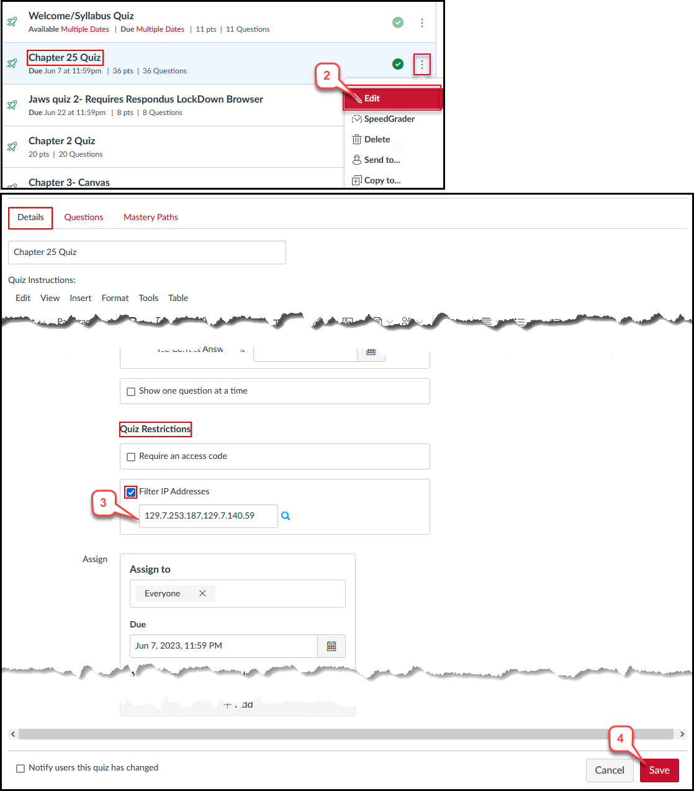

# AI-Firewall
This project is a simple Linux LAN/WAN Firewall scripts for usage in a classroom setting. It can be used in a classroom setting to allow approved websites and block common Generative AI services during computer based assessements in a classroom settings. 


## What these scripts do

- `check_ubuntu_packages.sh`
  - Checks for required Ubuntu packages and installs missing ones.
  - Re-runs itself with `sudo` if needed.
- `setup_system_settings.sh`
  - Validates the LAN and WAN interfaces exist.
  - Brings the LAN (WiFi hotspot) interface up and assigns a static IP via netplan (`/etc/netplan/01-hotspot.yaml`), then runs `netplan apply`.
  - Configures and starts `hostapd` using `/etc/hostapd/hostapd.conf` and `/etc/default/hostapd`.
  - Enables IPv4 forwarding immediately and persists it in `/etc/sysctl.conf`.
  - Applies base `nftables` NAT and forwarding rules for LAN → WAN routing (in dedicated `ai_firewall_*` tables/chains).
  - Writes base DNS/DHCP config to `/etc/dnsmasq.d/ai-firewall-base.conf` (includes DHCP range, upstream DNS servers, and DNS hardening options).
- `setup_firewall.sh`
  - Validates LAN/WAN interfaces and input files.
  - Loads allow-list domains into `ipset` via `dnsmasq`.
  - Blocks listed AI domains by writing null-address records in `dnsmasq`.
  - Resets and applies `iptables` rules (backs up current rules first).
  - Writes policy to `/etc/dnsmasq.d/ai-firewall-policy.conf`.
- `whitelist.txt`
  - Allowed domains/IPs, one entry per line (domain, IPv4, or IPv4 CIDR).
- `blocked_ai_domains.txt`
  - Blocked AI domains, one domain per line.

## Fresh Ubuntu setup (recommended order)

1. On the firewall host, clone this repo and enter it.
2. Identify your interface names:

```bash
ip -br link
```

3. Review domain policy files:
   - Edit `whitelist.txt` for allowed domains.
   - Edit `blocked_ai_domains.txt` for blocked AI domains.
   - `*.example.com` is accepted and normalized to `example.com`.
4. Install/check required packages:

```bash
./check_ubuntu_packages.sh
```

5. Run system setup with your real LAN/WAN interface names and hotspot settings:

```bash
sudo LAN_IF=wlx984827c3f4db WAN_IF=wlp3s0 LAN_CIDR=10.10.0.1/24 HOTSPOT_SSID=MyFilteredHotspot HOTSPOT_WPA_PASSPHRASE=StrongPassword123 ./setup_system_settings.sh
```

This writes `/etc/netplan/01-hotspot.yaml`, applies it (assigning the static IP to the hotspot interface), writes `/etc/hostapd/hostapd.conf` (with restricted file permissions), links it via `/etc/default/hostapd`, starts hostapd, enables IPv4 forwarding immediately and persists it in `/etc/sysctl.conf`, configures base nftables NAT/forwarding rules, persists them to `/etc/nftables.d/ai-firewall.nft` (and enables `nftables`), and configures dnsmasq DHCP/DNS service on the hotspot interface.
`HOTSPOT_WPA_PASSPHRASE` is required and must be 8-63 characters.
For better credential hygiene, avoid placing the passphrase directly in shell history on shared systems (for example: `read -rsp "Hotspot passphrase: " HOTSPOT_WPA_PASSPHRASE && echo && export HOTSPOT_WPA_PASSPHRASE` and then run the script).

6. Configure the WAN interface manually using your preferred network configuration method.

7. Apply firewall policy:

```bash
sudo LAN_IF=wlx984827c3f4db WAN_IF=wlp3s0 ./setup_firewall.sh
```

8. Configure student devices to use DHCP on the LAN hotspot (provided by `setup_system_settings.sh`) and use the firewall LAN IP as DNS so filtering is enforced. Static LAN addressing is optional if your deployment requires it.

## Important notes

- Run setup scripts as root (`sudo`).
- Default interface placeholders are `LAN` and `WAN`; you must override them unless your system uses those exact names.
- `setup_system_settings.sh` assigns a static IP to the hotspot interface via netplan, configures `hostapd`, enables IPv4 forwarding immediately and persists it via `/etc/sysctl.conf`, applies base nftables LAN↔WAN routing, and configures dnsmasq as a DHCP/DNS server.
- Hotspot credentials are stored in `/etc/hostapd/hostapd.conf`; this script sets file mode `0600` to restrict access.
- `setup_firewall.sh` flushes existing `iptables` rules and saves a backup at `/etc/iptables/ai-firewall.backup.v4`.
- `setup_system_settings.sh` expects both `dnsmasq` and `hostapd` to be managed by `systemctl`.

## Note for Instructors Using Canvas or Blackboard LMS

If you use **Canvas** or **Blackboard** (or a similar LMS) to administer in-class assessments such as quizzes or tests, configure the quiz to accept connections **only from the IP address of the AI-Firewall router machine** (the host where you installed this system).

This ensures that students must route their traffic through the firewall to reach the quiz, so the AI-blocking and domain-allow-listing policies are enforced for the entire assessment window.

**Steps (Canvas example):**

1. Open the quiz editor and go to the **Details** tab.
2. Locate the **IP Address Filter** (or *Allowed IPs*) setting.
3. Enter the **WAN IP address of the firewall router** — for example `128.83.120.168` — as the only allowed address. If your institution uses load balancers or proxies, you may need to add those IPs as well, or use CIDR notation (e.g. `10.20.30.0/24`). Consult your network administrator if you are unsure.
4. Save the quiz.

Students connecting from outside the filtered network will be denied access to the quiz, ensuring all their traffic is subject to the firewall's AI-blocking and domain-allow-listing policies.

> **Blackboard:** Go to *Test Options → IP Address Restrictions* and add the same firewall LAN IP.


